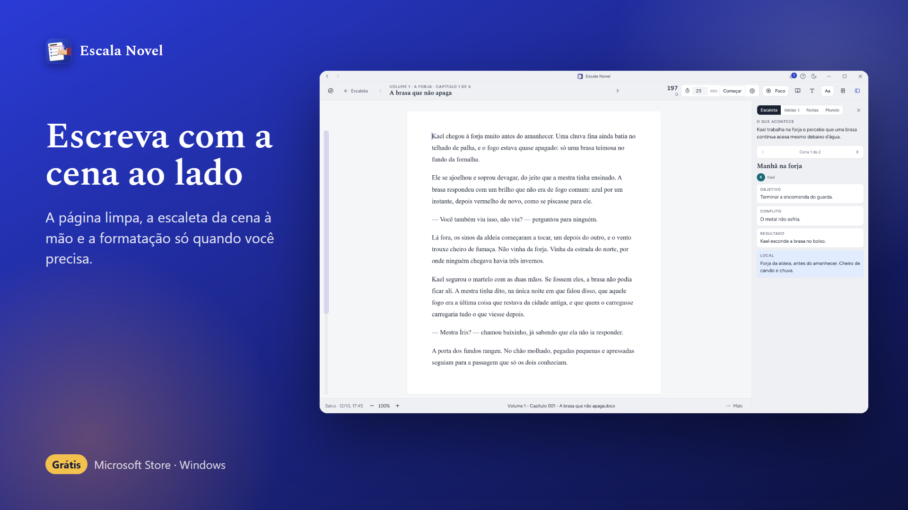
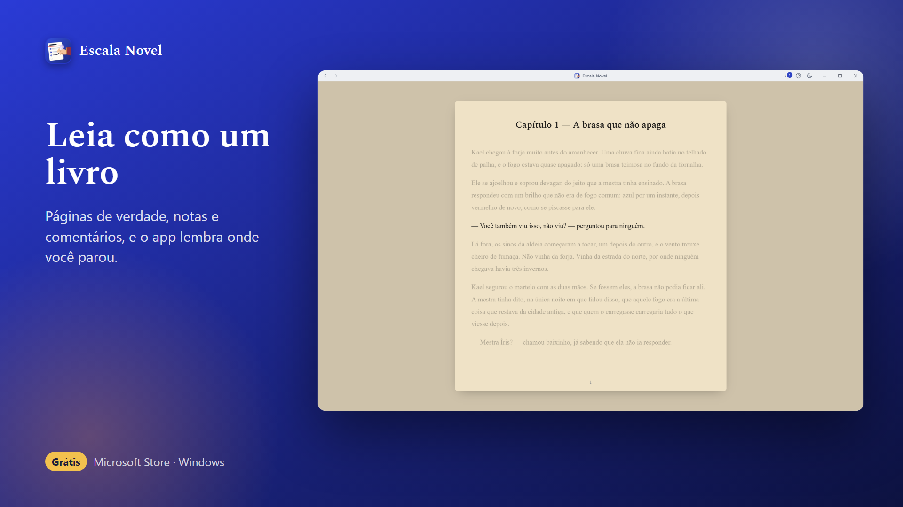
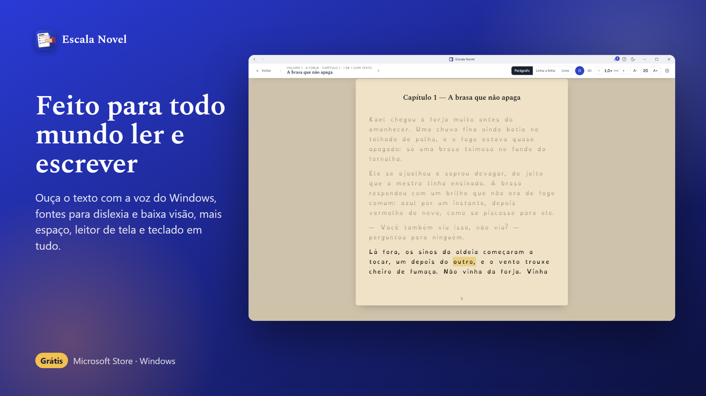
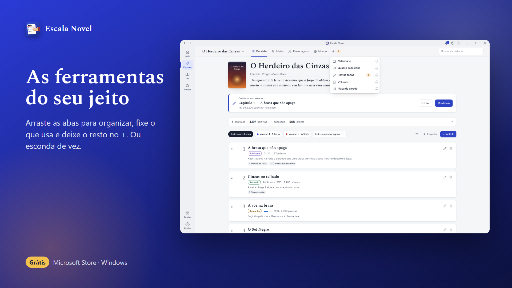
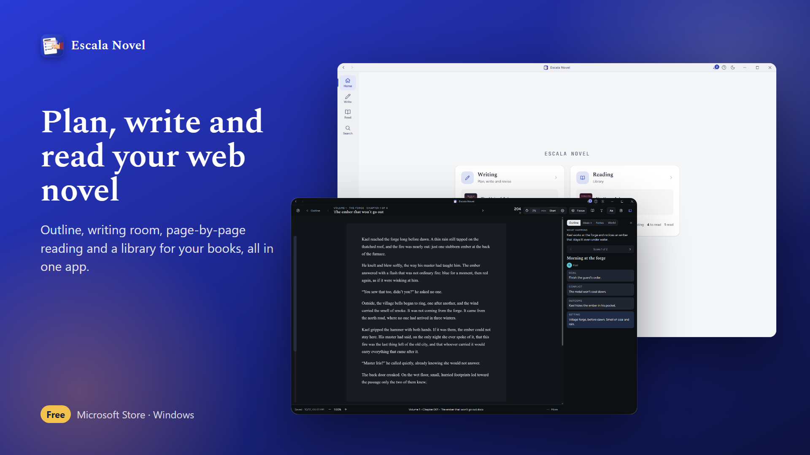

# Escala Novel

**Planeje, escreva, ouça e leia a sua história num lugar só.** Grátis para Windows.

[**Baixar na Microsoft Store**](https://apps.microsoft.com/detail/9P6BFRH2QPT3) (recomendado: instala e atualiza sozinho) ·
[Baixar o instalador](../../releases/latest) ·
[itch.io](https://escalanovel.itch.io/escala-novel)

*[English below](#english)*

## O que ele faz

- **Escaleta:** capítulos divididos em cenas e cartões (objetivo, conflito, resultado, pista), volumes, mapa de enredo, pontas soltas e calendário de publicação.
- **Escrita:** página limpa com a escaleta da cena ao lado, modo foco, temporizador, regras de fonte (janelas de sistema, pensamentos, mensagens) e o `.docx` de cada capítulo atualizado sozinho na sua pasta.
- **Leitura:** leia a história em páginas, como um livro, ou ouça com a voz do Windows. A Biblioteca guarda os seus livros (EPUB, PDF, Word, livros físicos e séries online).
- **Do seu jeito:** abas que você arrasta e organiza; as ferramentas que você não usa ficam escondidas.
- **Feito para todo mundo:** alto contraste, fontes para dislexia e baixa visão, leitor de tela e teclado em tudo.
- **Suas histórias são suas:** tudo fica no seu computador e na pasta que você escolher (Google Drive ou OneDrive, se quiser usar em mais de um computador).

| | |
|---|---|
|  |  |
|  |  |

## Instalar

1. O jeito mais fácil é a [Microsoft Store](https://apps.microsoft.com/detail/9P6BFRH2QPT3).
2. Ou baixe o instalador na página de [versões](../../releases/latest). Se o Windows mostrar "O Windows protegeu o computador", clique em **Mais informações** → **Executar assim mesmo** (o instalador ainda não tem assinatura digital paga; a versão da Store é assinada pela Microsoft).
3. Para conferir que o arquivo é original, compare o SHA-256 dele com o que está nas notas da versão (no PowerShell: `Get-FileHash "arquivo.exe"`).

Requisitos: Windows 10 ou 11, 64 bits. O manual completo fica dentro do app (tecla F1).

## Sobre este repositório

Aqui ficam só a apresentação e os arquivos para baixar. O código do Escala Novel não é aberto: o app é gratuito, mas é protegido por direitos autorais (veja [AVISO-LEGAL.md](AVISO-LEGAL.md)).

---

## English

**Plan, write, listen to and read your story in one place.** Free for Windows.

[**Get it on the Microsoft Store**](https://apps.microsoft.com/detail/9P6BFRH2QPT3) (recommended) · [Download the installer](../../releases/latest)

- **Outline:** chapters split into scenes and cards, volumes, plot map, loose ends and a release calendar.
- **Write:** a clean page with the scene outline beside it, focus mode, timer, font rules and a `.docx` of every chapter kept up to date.
- **Read:** read your story as book pages or listen with the Windows voice; a library for your EPUB, PDF and Word books and online series.
- **Your way:** drag the tabs to arrange them and hide the tools you do not use.
- **Made for everyone:** high contrast, fonts for dyslexia and low vision, screen reader and keyboard support everywhere.
- **Your stories are yours:** everything stays on your computer and in the folder you choose.

Interface in Portuguese, English, Spanish, Chinese, Japanese and Korean. Requires Windows 10 or 11 (64-bit).

This repository only hosts the presentation and the downloads; the source code is not open (see [AVISO-LEGAL.md](AVISO-LEGAL.md)).
